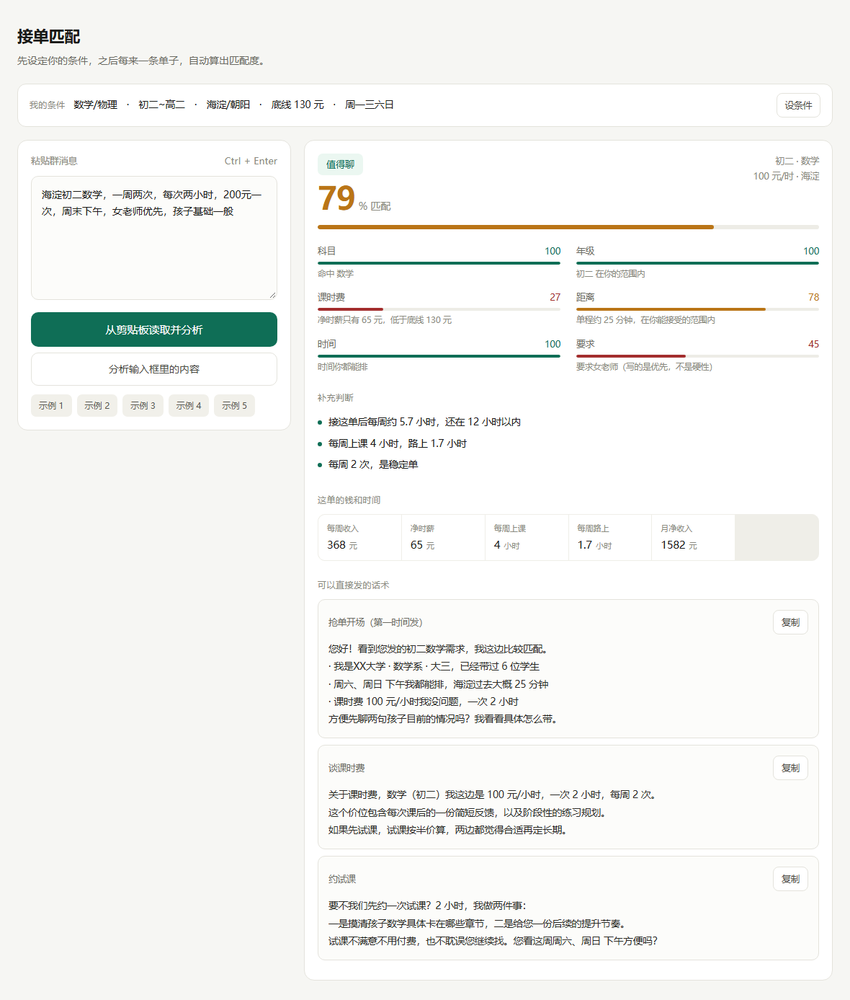
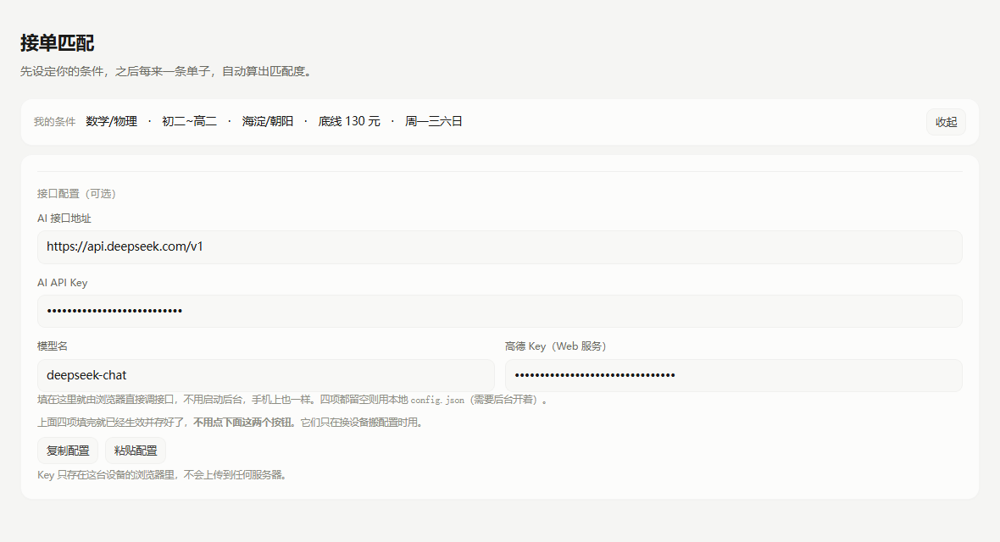

# 接单匹配 · Tutor Order Advisor


在微信群里复制一条家教单，旁边打开的页面半秒内告诉你：**这单值不值得接、实际能赚多少、开场话术怎么发。**

不用粘贴，不用切窗口，不用自己算时薪。



---

## 为什么做这个

家教群里发单的节奏很快，一条消息里塞着年级、科目、区域、频次、时长、报价、老师要求。人多的时候，一天几十条刷过去。

人脑判断这件事有三个问题：

1. **算不过来**。150 元两小时、单程 40 分钟、来回车费 8 元，实际时薪是多少？心算一遍要十几秒，十几秒后单子已经被别人接了。
2. **标准会飘**。昨天觉得 120 能接，今天累了觉得 150 才行。没有固定底线，就容易接一堆不划算的单。
3. **开场难写**。抢单拼的是前三句话，每次现想浪费时间。

这个工具把这三件事固化成一套流程：**先存好你的条件，之后每来一单，自动算出六维匹配度 + 净时薪 + 三段话术。**

---

## 它不做什么（先说清楚）

**它不读你的微信。** 个人微信没有任何消息接口，第三方协议方案有封号风险，也不合规。所以设计上彻底放弃"读群"，改成**读剪贴板**——你在微信里手动复制那一条，程序接住。

这带来一个明确的好处：**你复制什么，它才知道什么。** 聊天记录、联系人、朋友圈，一概碰不到。

关于这个话题的完整技术说明，见文档 [使用说明.html](使用说明.html) 第 09、10 章（GitHub 上点开只会显示源码，clone 下来双击用浏览器看，或者直接看本页下面的「隐私」和「常见问题」）。

---

## 功能

- **六维匹配度**：科目、年级、课时费、距离、时间、要求，各自打分后加权
- **净时薪**：扣掉往返通勤时间和车费之后的真实时薪，而不是名义报价
- **可选高德地图**：填一次出发点，按真实公交路线算通勤分钟数，精度从「区」到「点」
- **一次多条**：整段对话粘进去，自动拆单、逐条打分、按匹配度排序
- **三段话术**：抢单开场、谈课时费、约试课，按当前这单的具体情况生成，点一下复制
- **硬性 vs 软性**：写"女老师优先"只扣分不淘汰，写"只要女老师"才淘汰
- **可选 AI 补全**：单子写得太随意（"一周来两次""价格好商量"）时，让大模型补出规则认不出的字段
- **零依赖零安装**：前端单个 HTML，后端只用 Python 标准库，不需要 pip install

---

## 快速开始

**前置条件**：Windows 10 / 11，Python 3.9 或更高版本（[下载](https://www.python.org/downloads/)，安装时勾选 `Add python.exe to PATH`）。

**拿到代码**，两种方式选一种。

不想装 git 就下 ZIP，点这一下就行：[下载 ZIP](https://github.com/xiuqixiang515/Tutor-Order-Advisor/archive/refs/heads/main.zip)，解压到一个你找得到的位置（比如桌面）。

装了 git 的话：

```bash
git clone https://github.com/xiuqixiang515/Tutor-Order-Advisor.git
cd Tutor-Order-Advisor
```

> 解压后的文件夹叫 `Tutor-Order-Advisor-main`，`git clone` 出来的叫 `Tutor-Order-Advisor`，名字不一样都不影响，认准里面有 `启动监听.bat` 和 `index.html` 那一层就行。

然后双击 **`启动监听.bat`**。会弹出一个黑色窗口和浏览器页面：

```
  接单监听  已启动
  ------------------------------------
  地址   http://127.0.0.1:8791
  用法   在微信里选中消息 → 右键复制
         页面会自动出匹配结果
  AI     未配置 · 只用规则解析
  退出   在这个窗口按 Ctrl + C
```

看到这行字就成功了。**先点页面右上角「设条件」**，把你的科目、年级、能接受的区域和通勤时间、净时薪底线填进去，存一次就行（存在浏览器本地，下次不用再填）。配了高德的话，这里还要多填一项「我的出发点」。


推荐用 Chrome 或 Edge 打开，把这个页面钉在一个标签页里，或者放到第二块屏。

---

## 日常怎么用

1. 群里刷到一条单子
2. 选中消息 → 右键 → 复制（手机上就是长按 → 复制，如果同时开着电脑，用微信"文件传输助手"发到电脑再复制）
3. 页面自动跳出结果，**不用粘贴**

想临时试一条、不想复制，也可以直接粘进左边的输入框，点「分析输入框里的内容」。

---

## 手机上用

监听程序跑不了手机——iOS 不允许任何程序后台读剪贴板，Android 也受各家 ROM 限制，这是系统限制。但**页面本身能在手机浏览器里跑**，只是变成手动模式。

页面是纯前端单文件，不依赖后台。开 GitHub Pages 之后手机上访问：

```
https://xiuqixiang515.github.io/Tutor-Order-Advisor/
```

第一次用之前，仓库设置里开一下 Pages：**Settings → Pages → Source 选 `Deploy from a branch` → Branch 选 `main` / `/ (root)` → Save**，等一两分钟。

用法和电脑上唯一不同的是**没有自动监听**：

| | 电脑 | 手机 |
|---|---|---|
| 复制就出结果 | 有 | 没有 |
| 手动粘贴分析 | 有 | 有 |
| 点按钮读剪贴板 | 有 | 有（Pages 是 HTTPS，浏览器才允许） |
| AI 补全 / 高德通勤 | 有 | 有（在页面「接口配置」里填 Key） |
| 电脑必须开着 | 要 | 不要 |

手机上的流程是：微信里长按单子 → 复制 → 切到浏览器 → 点「从剪贴板读取并分析」。

浏览器里「分享 → 添加到主屏幕」，它会像 App 一样全屏打开。

页面底部有 5 个示例按钮，点一下就能看到各种单子的效果。

---

## 打分是怎么算的

六个维度各自打 0–100 分，然后加权：

| 维度 | 权重 | 怎么算 |
|---|---|---|
| 科目 | 26% | 命中你教的科目 = 100；不命中 = 0（硬性）；"全科"按你能覆盖的科目数给分 |
| 年级 | 20% | 在你的年级范围内 = 100；不是 = 0（硬性）；单子没写年级 = 55 |
| 课时费 | 20% | 按**净时薪**算，超过理想值 = 100，在底线和理想之间线性给分，低于底线按比例衰减 |
| 距离 | 16% | 线上课 = 100；超距按超出比例衰减；配了高德就用真实通勤分钟数，否则查你手填的区域表；查不到的给 55 分（不会一刀切判死） |
| 时间 | 13% | 全都能排 = 100；部分冲突 = 55；全冲突 = 0（硬性）；没说星期几 = 60 |
| 要求 | 5% | 性别 / 教资 / 竞赛 / 名校 / 你的排除词，命中硬性要求 = 0 |

**净时薪**是这个工具的核心指标：

```
净时薪 = (每周课时费收入 − 每周往返车费) ÷ (每周上课小时数 + 每周通勤小时数)
```

名义 150 元/小时、单程 40 分钟、车费 8 元的单，净时薪大概是 70 出头。**这一个数字就能筛掉大部分看着不错其实不划算的单。**

**硬性不符的降权**：如果科目、年级、时间、要求这四项里有任何一项是 0 分，总分乘以 `0.38`。这里没有直接判 0 分，是为了让"科目对但年级差一级"和"科目年级全错"仍然能排出高低。

总分对应四档建议：

| 分数 | 结论 |
|---|---|
| ≥ 85 | 高度匹配 |
| 70–84 | 值得聊 |
| 50–69 | 一般，看情况 |
| < 50 | 不建议接 |

这些权重和阈值都写在 `index.html` 的 `computeMatch()` 里，觉得不顺手可以直接改数字。

---

## 可选：AI 补全

规则解析只认常见写法。遇到这种单子就抓瞎：

> 孩子高二数学老是七十多分上不去，一周来两次就行，价格好商量

「来两次」认不出是每周两次，课时费完全没有。这类缺字段的情况可以交给大模型补。

**设计上做了取舍**：规则先跑（0.4 秒），结果立刻渲染；只有发现关键字段缺失，才在后台调一次 AI，拿到后**只填空，不覆盖规则已经认出来的内容**，然后重算匹配度。所以开了 AI 也不会变慢。

触发补全的只有这五个字段：**年级、科目、频次、单次时长、课时费**。

### 怎么配

**方式一：在页面里填（推荐，手机也能用）**

点页面右上角「设条件」，拉到最底下「接口配置」那一组，填三样：

| 字段 | 填什么 |
|---|---|
| AI 接口地址 | `https://api.deepseek.com/v1` |
| AI API Key | 你申请的 `sk-` 开头的 Key |
| 模型名 | `deepseek-chat` |

填完收起面板就生效，**不用再点别的按钮**。Key 存在浏览器的 localStorage 里，不会上传到任何服务器，也不需要启动后台——手机上打开同一个页面填一遍，AI 照样能用。

换设备时不用重填：点「**复制配置**」，到新设备点「**粘贴配置**」把那段贴进去。



**方式二：写在 config.json 里（只对电脑后台生效）**

1. 把 `config.example.json` 复制一份，改名 `config.json`
2. 填 `api_key`，保存
3. 重启监听程序，黑窗口里会多一行 `AI  已开启（模型名）`

```json
{
  "base_url": "https://api.deepseek.com/v1",
  "api_key": "sk-你的key",
  "model": "deepseek-chat",
  "timeout": 20
}
```

> 两种方式都配了的话，**以页面里填的为准**。都不配就只跑规则，其他功能不受影响。

都是 OpenAI 兼容接口，换厂商只改这三行：

| 厂商 | base_url | 常用 model |
|---|---|---|
| DeepSeek | `https://api.deepseek.com/v1` | `deepseek-chat` |
| Kimi | `https://api.moonshot.cn/v1` | `moonshot-v1-8k` |
| 智谱 | `https://open.bigmodel.cn/api/paas/v4` | `glm-4-flash`（基本免费） |
| 通义千问 | `https://dashscope.aliyuncs.com/compatible-mode/v1` | `qwen-plus` |

不想写文件也可以用环境变量覆盖：`AI_BASE_URL` / `AI_API_KEY` / `AI_MODEL`。

### 出问题不会影响主流程

没配 key、key 失效、网络不通、模型返回格式不对——都会在匹配度下面显示一句原因，然后**退回纯规则结果**。AI 是加分项，不是必需品。

---

## 可选：高德地图算真实通勤

默认距离用的是「区 → 分钟」查表，粒度只到区。同样在朝阳，望京和国贸能差四十分钟。

配上高德之后：你填一次出发点，单子里的地点转成坐标，按**真实公交路线**取时长，距离维度和净时薪跟着重算。

> 这里要澄清一件事：**地图能力不该交给大模型**。大模型不知道你住哪、也没有路网数据，让它估通勤时间只能靠印象编。地名标准化（「人大附中旁边」→ 「人大附中」）可以让 AI 做，但分钟数必须来自地图 API。

### 怎么配

1. 去 [高德开放平台](https://lbs.amap.com/) 注册，完成个人开发者认证
2. 控制台创建应用 → 添加 Key，**服务平台选「Web 服务」**（选成 JS API 会调不通）
3. 把 Key 填进**页面「设条件 → 接口配置 → 高德 Key」**（手机也能这么配），或者填进 `config.json` 的 `amap_key`
4. 回到「在哪教」里填**我的出发点**，学校、地铁站都行

```json
{
  "amap_key": "你的高德 Web 服务 Key"
}
```

页面里填的优先级高于 `config.json`。也可以用环境变量 `AMAP_KEY` 覆盖后台那份。

### 行为

- 同一地点只查一次，进程内缓存复用，省额度
- 公交优先，步行和驾车兜底
- 查到后界面上会标「高德实测·公交」，跟手填的结果分得开
- 查不到（没配 Key / 地点太模糊 / 网络问题）→ **退回手填的区域时间并显示原因**，不会编数字
- 改了出发点，之前算出的通勤时间自动作废，下次打开重新查

---

## 隐私

| 场景 | 数据流向 |
|---|---|
| 什么都不配（默认） | **完全不联网**。剪贴板内容只在内存里，解析全在本机 JS 里完成 |
| 配了 AI | 仅在关键字段缺失时，把**这一条单子的原文**发给厂商 API |
| 配了高德 | 把**你的出发点和单子里的地点**发给高德，用于地理编码和路径规划 |
| 你的条件画像 | 存在浏览器 `localStorage`，不上传任何地方 |
| 页面里填的 Key | 同样只在 `localStorage`，不出这台设备。换设备要手动复制粘贴 |
| `config.json` | 只在本地读，已在 `.gitignore` 里，不会被提交 |

单子里可能带家长手机号、小区名。开这两个之前想清楚，或者复制时先把敏感信息删掉。

另外提醒一句：**别在公共电脑上填 Key**。Key 存在浏览器里，同一台机器换个人用就看得见（密码框虽然打成圆点，但开发者工具里能读到明文）。

---

## 项目结构

```
tutor-order-advisor/
├── index.html              前端全部内容：解析、打分、话术、UI（单文件，无外部依赖）
├── clip_watch.py           常驻监听：读剪贴板 + 本地 HTTP 服务 + 可选 AI / 高德调用
├── 启动监听.bat            双击启动，自动找 Python
├── config.example.json     AI 与高德 Key 的配置模板
├── 使用说明.html           完整的 Windows 图文使用文档（十一章）
├── manifest.webmanifest    PWA 清单
├── icon-*.png              图标
├── tests/
│   └── test_clip_watch.py  单元测试 + 接口集成测试
└── docs/screenshots/       README 用的截图
```

**架构**：计算全部在前端 JS 里，Python 只干两件事——盯着剪贴板，和把新单子通过接口交给页面。所以前端可以脱离监听程序单独打开使用（手动粘贴），只是没有自动捕获。

### 本地接口

服务只监听 `127.0.0.1`，端口从 `8791` 起，被占用就顺延到 `8800`。

| 方法 | 路径 | 说明 |
|---|---|---|
| GET | `/latest` | `{seq, text, ts}`，seq 变化 = 有新单子 |
| GET | `/ai-status` | `{enabled}`，前端据此决定要不要走 AI 链路 |
| GET | `/map-status` | `{enabled}`，有没有配高德 Key |
| GET | `/ping` | 健康检查 |
| GET | `/` | 返回 index.html |
| POST | `/parse` | `{text}` → AI 补全结果 `{ok, data}` 或 `{ok:false, error}` |
| POST | `/commute` | `{from, to, city?}` → `{minutes, mode, meters, destName}` 或 `{ok:false, error}` |

---

## 开发与测试

不需要任何第三方包。

```bash
# 跑测试（35 个，含真起服务的接口测试和假高德链路）
python -m unittest discover -s tests -v

# 启动时不自动开浏览器，方便调试
python clip_watch.py --no-open
```

改前端只要刷新页面。改 `clip_watch.py` 要 `Ctrl + C` 重启。

**想贡献**：提 Issue 说清楚是哪种单子解析错了（把原文贴上来，敏感信息打码），或者直接 PR。改解析规则的话，麻烦在 `tests/test_clip_watch.py` 里补一条对应的用例。

---

## 已知局限

- **监听程序只有 Windows 版**。读剪贴板用的是 Win32 API（`user32.OpenClipboard`）。页面本身跨平台，手机浏览器打开照样能手动分析。macOS / Linux 上想做监听得换成 `pbpaste` / `xclip`，各几十行，目前没做。
- **规则解析总有认不出的写法**。这是可选 AI 补全存在的原因，但关了 AI 就只剩规则。
- **区域通勤时间要你自己填**。程序不知道你住在哪，默认只能按你给每个区的分钟数估。配了高德才会按真实路线算。
- **地图是「选配」不是「内置」**。不配 Key 就没有地理能力，这是刻意的——不想让一个纯本地工具变成必须联网才能用。
- **话术是模板生成的**，不是 AI 写的。逻辑是固定的，好处是稳定可控，坏处是不够个性化。

---

## 常见问题

**双击 bat 闪退？**
没装 Python，或者装了但没勾 `Add python.exe to PATH`。在命令行里跑 `python --version` 验证一下。

**页面打开了但没有那条绿色监听条？**
说明没连上后端。先确认黑色窗口还开着，再手动访问 `http://127.0.0.1:8791/ping`，能看到 `{"ok":true}` 就正常。

**复制了单子但没反应？**
程序有防误触规则：长度 10–4000 字符、不是网址、至少命中两个特征词、并且带价格线索（元/块/课时费/时薪）。要求写得太简略（比如只说"找数学老师"没说价格）就不会触发。这时手动粘进输入框即可。

**端口被占用？**
会自动顺延到 8800。如果 8791–8800 全被占，关掉占用端口的程序再试。

**杀毒软件报警？**
程序会读剪贴板 + 起本地端口 + 开浏览器，行为上确实像"疑似监控软件"。后台只有 `clip_watch.py` 一个文件、六百多行，纯标准库无依赖，全部可读，自己扫一遍就知道了。不放心可以不双击 bat，直接用命令行跑 `python clip_watch.py`。

**从 GitHub 下载 ZIP 解压后，双击 bat 弹「Windows 已保护你的电脑」？**
浏览器给下载的文件打了「来自 Internet」标记，Windows 对带这个标记的脚本会拦一下。点「更多信息」→「仍要运行」即可。介意的话，右键 ZIP 属性勾选「解除锁定」再解压，就不会有这个提示。

**能做成手机 App 吗？**
监听那部分不行：iOS 不允许任何程序在后台读剪贴板，Android 的通知监听也受各家 ROM 限制，这是系统层面的限制，不是没做。

但页面能在手机浏览器里跑。开 GitHub Pages 后手机访问同一个地址，手动粘贴（或点按钮读剪贴板），打分、话术、AI 补全、高德通勤全都能用，只是没有「复制就自动出结果」。详见上面的「手机上用」。

---

## License

[MIT](LICENSE)。随便用、改、商用，保留版权声明就行。

如果这东西帮你多接了几个划算的单，欢迎回来点个 Star。
